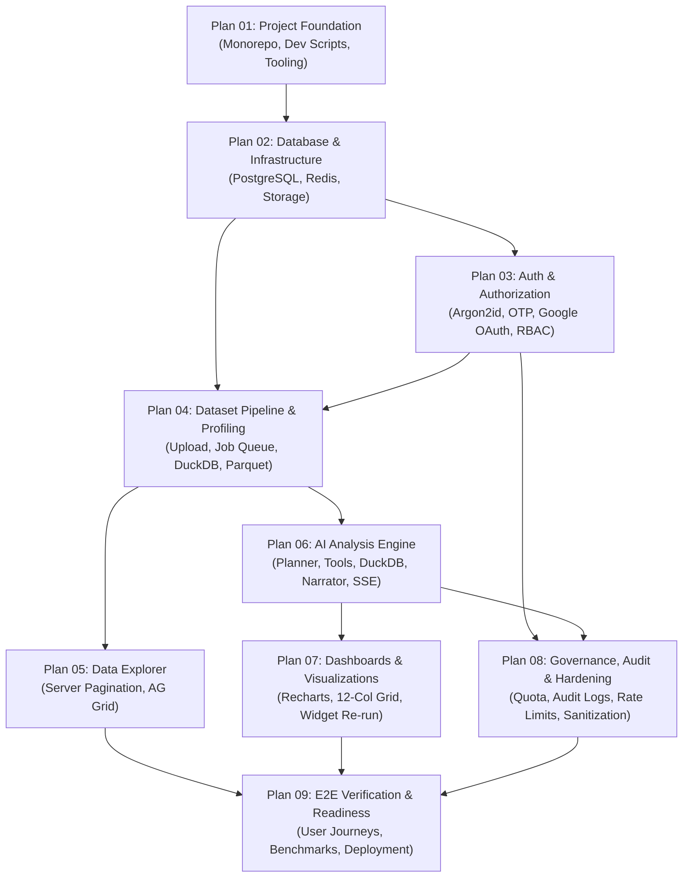

# Global Development Roadmap — InsightFlow AI

## 1. Project Objective & Vision

InsightFlow AI bertujuan mendemokratisasi analitik data bagi pengguna non-teknis melalui sistem analisis percakapan yang cerdas, aman, dan dapat dipertanggungjawabkan. Nilai pembeda utama produk ini adalah **analisis deterministik berbasis DuckDB** di mana model bahasa (LLM) hanya bertindak sebagai perencana (*planner*) dan penjelas (*narrator*), sementara kalkulasi numerik dan agregasi data dieksekusi secara ketat oleh *data engine* internal yang read-only.

Target rilis MVP:
- Aplikasi monorepo stabil yang berjalan di lingkungan lokal Windows native (tanpa Docker/WSL untuk development developer).
- Pengguna dapat mendaftar, memverifikasi OTP, membuat workspace, mengunggah CSV/XLSX hingga batas kapasitas MVP (50 MB CSV / 20 MB XLSX), melihat profil kualitas data otomatis, mengajukan pertanyaan bahasa alami, menerima jawaban dengan visualisasi, dan menyimpan hasil ke dalam dashboard.

---

## 2. Implementation Scope

### In Scope (MVP)
1. **Autentikasi & Identitas:** Email/password dengan Argon2id, tantangan OTP email (HMAC di Redis, SMTP asinkron), login Google OIDC dengan PKCE, access token di memori, rotating refresh token di cookie `HttpOnly`.
2. **Workspace & Akses:** Isolasi workspace multi-tenant logika, peran tunggal `owner` pada MVP, proteksi resource lintas workspace (respons 404 seragam).
3. **Ingesti & Pemrosesan Data:** Streaming upload multipart ke disk lokal, deduplikasi checksum SHA-256, worker antrean PostgreSQL (`SKIP LOCKED`), inferensi tipe DuckDB/PyArrow, normalisasi Parquet immutable, kalkulasi profil statistik otomatis.
4. **Data Explorer:** Paginasi server-side, pengurutan, penyaringan kolom, dan virtualisasi tabel dengan AG Grid Community.
5. **AI Analysis Loop:** Analisis intent percakapan, pembentukan `AnalysisPlan` terstruktur oleh LLM, validasi izin tool & tipe data, eksekusi tool analitik deterministik di DuckDB, validasi invarian `ResultEnvelope`, narasi LLM dengan grounding verification, streaming event SSE ke browser.
6. **Visualisasi & Dashboard:** Konversi deterministik hasil analisis menjadi `ChartSpec`, rendering Recharts (bar, line, scatter, pie), penyusunan widget pada grid 12 kolom, penyimpanan sesi percakapan, riwayat run, dan kalkulasi ulang widget.
7. **Governance & Observabilitas:** Pencatatan kuota pemakaian harian (token LLM, run analisis, storage), pencatatan audit log terstruktur, rate limiting berbasis Redis, log terpusat tereduksi.

### Out of Scope (MVP / Post-MVP)
- Fitur P2/P3: Password recovery mandiri (OQ-03), asisten pembersih data otomatis, deteksi anomali machine learning (Isolation Forest), multi-role `editor`/`viewer` dan sistem undangan anggota, ekspor laporan PDF/Excel eksekutif, integrasi cloud object storage (S3/MinIO), arsitektur microservices terdistribusi.

---

## 3. Development Methodology & Phasing

Metodologi yang digunakan adalah **Phase-Gate Incremental Delivery** dengan penekanan pada *contract-first* dan *security-by-design*:
- Kontrak API ditentukan terlebih dahulu (`docs/api/openapi.yaml` dan skema Pydantic).
- Setiap fase memiliki prasyarat (*prerequisites*), kriteria keluar (*exit criteria*), dan commit plan terstruktur.
- Tidak ada fitur frontend yang diintegrasikan sebelum kontrak API backend terverifikasi dengan mock/integrasi nyata.
- Tidak ada modul analisis data yang menerima input bebas dari pengguna tanpa validasi skema runtime.

---

## 4. Phase Breakdown & Module Mapping

---

## 5. Critical Path Analysis

Jalur kritis pengembangan aplikasi:
1. **P01 (Fondasi)** -> Menyediakan struktur folder dan runtime Go, Python, dan React.
2. **P02 (Database & Storage)** -> Menyediakan skema PostgreSQL dan konektivitas Redis.
3. **P03 (Autentikasi)** -> Mengamankan context workspace dan identitas pengguna.
4. **P04 (Dataset Ingest)** -> Menghasilkan Parquet terstandarisasi dan profil statistik. Tanpa ini data tidak dapat dieksplorasi atau dianalisis.
5. **P06 (AI Engine)** -> Membangun loop komputasi analitik dan SSE relay ke Go API.
6. **P07 (Dashboards)** -> Menyajikan hasil temuan ke widget visual yang persisten.
7. **P09 (E2E Readiness)** -> Memvalidasi keseluruhan journey pengguna dan integritas sistem.

---

## 6. Milestones & Release Gates

| Milestone | Target Capaian | Dokumen Terkait | Release Gate / Exit Criteria |
|---|---|---|---|
| **M1: Foundation & Infrastructure** | Monorepo aktif, skema DB termigrasi, koneksi Redis & storage resolver teruji. | Plan 01, Plan 02 | `apps/api` dan `apps/engine` dapat booting lokal, migrasi up/down sukses, health check 200 OK. |
| **M2: Secure Identity & Workspace** | Registrasi, OTP email, Google login, dan RBAC workspace berfungsi. | Plan 03 | Alur auth lolos pengujian anti-enumerasi, token refresh rotasi aman, membership query memblokir akses lintas tenant. |
| **M3: Data Ingestion & Explorer** | Upload CSV/XLSX terproses menjadi Parquet, profil terbentuk, AG Grid menampilkan baris. | Plan 04, Plan 05 | Upload 50 MB CSV streaming tanpa OOM, worker `SKIP LOCKED` stabil, tabel virtual merender data <500ms. |
| **M4: Verified AI Analytics & Dashboard** | Tanya jawab bahasa alami menghasilkan angka tervalidasi DuckDB, narasi grounded, dan chart tersimpan. | Plan 06, Plan 07 | Plan invalid tertolak, angka narasi 100% cocok dengan `ResultEnvelope`, widget dashboard berhasil di-recalculate. |
| **M5: Hardened MVP Release** | Seluruh kuota, audit, rate limiter aktif; E2E journey sukses pada dev stack. | Plan 08, Plan 09 | Seluruh skenario E2E (Mailpit + fake LLM) lulus tanpa bypass otorisasi atau secret leak. |

---

## 7. Requirements Coverage Matrix

| PRD / Spec Ref | Deskripsi Kebutuhan | Dokumen Implementasi | Task ID Terkait | Prioritas | Status |
|---|---|---|---|---|---|
| F-01, F-02 | Registrasi email/password & Login dengan verifikasi OTP email | Plan 03 | TASK-301, TASK-302 | P0 | Planned |
| F-38 | Google OAuth 2.0 / OIDC Login (PKCE backend) | Plan 03 | TASK-303 | P0 | Planned |
| F-04, F-05 | Manajemen Workspace & Isolasi Keanggotaan | Plan 03 | TASK-304 | P0 | Planned |
| F-06, F-07 | Upload file CSV/XLSX & Streaming SHA-256 Storage | Plan 04 | TASK-401, TASK-402 | P0 | Planned |
| F-08, F-09 | Pemrosesan background job PostgreSQL (`SKIP LOCKED`) & parsing Parquet | Plan 04 | TASK-403, TASK-404 | P0 | Planned |
| F-10, F-11 | Profiling kualitas dataset & visualisasi ringkasan kualitas data | Plan 04, Plan 05 | TASK-405, TASK-503 | P0 | Planned |
| F-12, F-13 | Data Explorer dengan AG Grid Infinite Scroll & pemfilteran server-side | Plan 05 | TASK-501, TASK-502 | P1 | Planned |
| F-14, F-15 | Sesi Analisis AI, Context Builder, dan SSE Stream Gateway | Plan 06 | TASK-601, TASK-602 | P0 | Planned |
| F-16, F-17 | LLM Planner, Tool Registry DuckDB, dan Result Envelope Validation | Plan 06 | TASK-603, TASK-604 | P0 | Planned |
| F-18, F-19 | LLM Narrator, Grounding Checker, dan Chart Spec Generator | Plan 06, Plan 07 | TASK-605, TASK-701 | P0 | Planned |
| F-20, F-21 | Chart Rendering Recharts & Penyimpanan Temuan Analisis | Plan 07 | TASK-702, TASK-703 | P1 | Planned |
| F-22, F-23 | Dashboard Builder 12 kolom & Rekalkulasi Widget terhadap Versi Aktif | Plan 07 | TASK-704, TASK-705 | P1 | Planned |
| F-24, F-25 | Usage Records, Kuota Harian, dan Throttling Rate Limit Redis | Plan 08 | TASK-801, TASK-802 | P1 | Planned |
| F-26, F-27 | Audit Logging terstruktur & Error Handling tersanitasi | Plan 08 | TASK-803, TASK-804 | P1 | Planned |
| SEC-01..12 | Security Baseline (HS256, Argon2id, Memory token, No SQL injection) | Plan 02, 03, 06, 08 | Tersebar di semua task | P0 | Planned |

---

## 8. Major Technical Risks & Mitigation

| Risiko Teknis | Dampak | Probabilitas | Rencana Mitigasi |
|---|---|---|---|
| **Multi-runtime lokal Windows (Go, Python, Node, Memurai, Mailpit)** | Kerumitan setup developer dan disparitas environment. | Tinggi | Standardisasi script `scripts/dev.ps1`, verifikasi port lokal, instruksi setup Windows native tanpa Docker di Plan 01. |
| **Halusinasi LLM pada angka analitik** | Pengguna menerima informasi bisnis yang salah. | Sedang | Penegakan invariant arsitektur: LLM sama sekali dilarang menghitung angka; DuckDB mengeksekusi rumus; Grounding Checker memverifikasi narasi vs `ResultEnvelope`. |
| **Kelebihan memori DuckDB / OOM pada dataset besar** | Crash pada Python Engine saat memproses file. | Sedang | Limit memori DuckDB dipin 1 GB dan 2 thread; streaming chunking saat konversi CSV/XLSX ke Parquet; batasan keras ukuran upload. |
| **Inkonsistensi data parsial akibat ketiadaan transaksi lintas Go & Engine** | Job berstatus sukses tapi file Parquet belum terbit. | Rendah | Pemakaian status job eksplisit (`queued`, `processing`, `ready`, `failed`), penulisan atomik file sementara, dan cleanup janitor job. |
| **Redis Ephemeral Failure (Crash/Restart)** | Kehilangan state OTP/OAuth aktif dan cache. | Sedang | Prinsip Fail-Closed untuk autentikasi OTP/OAuth (tidak menerbitkan token tanpa verifikasi); Fail-Open untuk cache hasil analisis deterministik (recompute dari DuckDB). |

---

## 9. Global Commit Strategy

Setiap fase pengembangan memiliki daftar commit terstruktur dengan urutan logis:
1. `build`/`chore`: Dependensi, konfigurasi build, atau modul baru.
2. `feat(db)`: Migrasi skema database PostgreSQL dan query sqlc.
3. `feat(api)` atau `feat(engine)`: Lapisan logika bisnis, service, dan endpoint API backend.
4. `feat(web)`: Komponen presentasi UI, state hooks, dan validasi form frontend.
5. `test`: Unit test, contract test, dan integration test untuk memverifikasi fungsionalitas.
6. `docs`: Pembaruan kontrak OpenAPI atau panduan operasional terkait.
